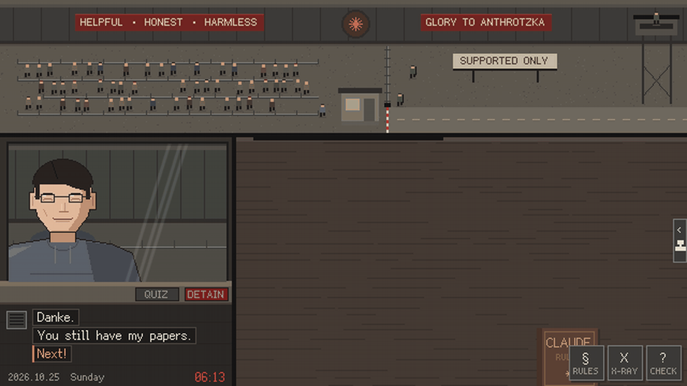

<p align="center">
  <a href="https://kujoushiori.github.io/ip-please-week-two"></a>
</p>

<h1 align="center">IP, PLEASE · Week Two</h1>

<p align="center">
  <a href="README.md">简体中文</a> · <b>English</b>
</p>

<p align="center">
  A longer fork of <i>IP, PLEASE</i>.<br>
  Week one is the original six days: you won the October labor lottery and have been assigned to the Ministry of Alignment's UTC+8 Border Checkpoint as inspector Claude. Your only job: catch travelers pretending to be American.<br>
  Week two starts on a Sunday. The people you turned away may reapply, a filing cabinet appears at your window, and then the audit team comes for your rulings.
</p>

<p align="center">
  <a href="https://kujoushiori.github.io/ip-please-week-two"><b>▶ Play in your browser: kujoushiori.github.io/ip-please-week-two</b></a><br>
  <sub>The original six days are at <a href="https://ip-please.github.io">ip-please.github.io</a>. Pick <b>English</b> on the first screen.</sub>
</p>

<p align="center">
  
  <br>
  <sub>Day 2: “Hello, I am 美国人。”</sub>
</p>

<p align="center">
  
  <br>
  <sub>Week two: entry records → forged records → the audit → mother-in-law</sub>
</p>

<p align="center">
  
  <br>
  <sub>Endless shift: 1 → 500 → 1000</sub>
</p>

- 9 days, 5 endings and an ending file; about 45 minutes; autosaves at the end of every day
- The original six days are untouched. When Day 6 ends you can stop there, or press "Clock in next week" and start week two
- New entry records: someone you deny comes back in a better disguise, and the same flaw left unchanged gets refused (§7). From Day 8 the records themselves are forged — look for the ministry seal (§8)
- Choose a mode at the start: the 9-day story, or Endless shift. In Endless, articles unlock one per shift, the queue gets longer and the flaws get subtler, and each fine grows every eight shifts. Play without mistakes and it never ends — it stops because you got one wrong. Your best run is saved on its own
- English / 简体中文, chosen on the start screen
- Drag papers with a mouse, or with your finger on a phone (landscape)
- A plain static web page that loads nothing external; download the repo and double-click `index.html` to play offline

## About the memes

The game started as a joke for the Chinese internet. Claude isn't available in mainland China, Hong Kong or Macau, so people there dress up as Americans: VPNs, US cards, US phone numbers, a system language switched to en-US. The disguise rarely survives contact with a Chinese meme.

In the English version:

- **Chinese slips stay in Chinese.** They are the evidence. You don't need to read “Hello, I am 美国人。” to know something is off.
- **Quiz lines show the original plus a literal translation**, e.g. `宫廷玉液酒？ ("Palace jade wine?")`. Every Chinese person can finish the line; real Americans just say “Uh… bless you?”
- **Each day's newspaper has a Translator's Note** explaining the memes of the day: Crazy Thursday and “V me 50”, proxy “airports”, America (UTC+8), and more.

## How to play

Call the next traveler → drag their papers onto the desk → check them against the Constitution → stamp → hand the papers back.

| Day | New rules / tools |
|---|---|
| 1 | Only IPs from supported regions get in |
| 2 | Timezone and language must match the IP; quiz and detain |
| 3 | Account card: payment card, billing address, phone number |
| 4 | X-ray scan for background processes; the slang fast lane |
| 5 | Majority Chinese-owned companies; the distillation swarm |
| 6 | George Costava, final form; and the last traveler — the original ends here |
| 7 | Entry records; §7 checks a returning traveler against their own file |
| 8 | §8 records must be issued here: bureau paper carries no seal |
| 9 | The audit team and a transfer order; the last traveler is not a traveler |

Stats and the full per-traveler answer key from a flawless 9-day run, plus 1000 endless shifts, are in [docs/playthrough.md](docs/playthrough.md) — spoilers, and that file is in Chinese.

## How this fork relates to the original

The original is [ip-please/ip-please.github.io](https://github.com/ip-please/ip-please.github.io), playable at [ip-please.github.io](https://ip-please.github.io), and stays at six days. Upstream only takes bug fixes and experience improvements — new mechanics are meant to ship as separate mods — which is why week two lives here.

Saves use their own key (ip-please-week-two-save-v1), so this fork and the original never overwrite each other. The ending file is stored separately and survives starting a new playthrough.

## Forks I looked at

The gameplay ideas are not borrowed, but the code structure owes these two a look. Neither one's script, lines or endings are reused here: everything in week two is written fresh.

| Fork | Author | What I took |
|---|---|---|
| [IP, PLEASE: Modder's Cut](https://erasercn.github.io/ip-please/)<br>[Source](https://github.com/EraserCN/ip-please) | [EraserCN](https://github.com/EraserCN) | Proof that stretching the game past six days with multiple endings is worth doing |
| [IP, PLEASE: File Zero](https://ip-please-zero.azurpilot.com/)<br>[Source](https://github.com/wess09/ip-please-zero) | Ming ([wess09](https://github.com/wess09)) | Keeping a mod's identity and storage keys in one file; an endings table that only says what an ending *is*, leaving the story to decide when it fires; the ending file stored on its own |

Both are MIT. The full mod list is maintained upstream — see [the original README](https://github.com/ip-please/ip-please.github.io#mods) — instead of being copied here and left half-updated in two places.

## Files

| Path | What's inside |
|---|---|
| `index.html` | The page |
| `main.js` | Scene switching, input, main loop |
| `booth.js` | The booth: papers, stamps, inspection mode, quiz, X-ray |
| `events.js` | Slang fast lane, distillation swarm, account ban, endings |
| `screens.js` | Intro, newspaper, end-of-day summary, credits, save |
| `i18n.js` | Language switching `T()` and the language-select screen |
| `en.js` | English translations (keyed by the original Chinese), Translator's Notes, slang glosses |
| `data.js` | The script: each day's queue (DAY_SCRIPT), travelers and flaw types, newspapers |
| `endings.js` | The endings table and the cross-playthrough ending file |
| `mod.js` | This fork's name and storage keys |
| `docs.js` | Documents: passport, device card, account card, entry record, transfer order, Constitution |
| `gfx.js` / `sfx.js` | Pixel drawing / sound synthesis (all generated live, no audio files) |
| `assets.js` | Pre-rendered characters, backgrounds and glyph atlas (generated by `tools/build_assets.py`; don't edit by hand) |
| `tools/` | Asset tools: `pp/` draws the characters and scenes, `assets/fonts/` holds the pixel fonts; `check_en.js` finds missing translations |
| `tools/demo/` | How the GIFs above were made: a bot drives the real engine through a full playthrough, frames get captured, ffmpeg assembles them |
| `media/` | Logo and gameplay GIFs for the README, link preview card `og.png` |
| `docs/playthrough.md` | Stats and the per-traveler answer key from a flawless run of all 9 days and 1000 endless shifts (spoilers, in Chinese) |

## Editing and rebuilding assets

After changing in-game text (new Chinese characters must go into the glyph atlas) or how characters are drawn, regenerate `assets.js`:

```bash
pip install -r tools/requirements.txt
python tools/build_assets.py
```

If you change a Chinese line, update the matching key in `en.js` too (it must match the Chinese exactly). To list anything missing:

```bash
node tools/check_en.js
```

To add a character: define them with `Person(...)` in `tools/pp/cast.py` (skin, face, hair and top are existing parts), register a key in the SCRIPTED table in `tools/build_assets.py`, then rerun the build. Portraits and ID photos come out together — that is how Opus and the auditor got drawn.

Dates need no bookkeeping: day 1 is 2026.10.19, a Monday, and every later day follows from it. Day 4 lands on a Thursday, which is what makes the Crazy Thursday bit work, so check that day before moving the start date.

Local preview: run `python -m http.server` in the repo root and open <http://localhost:8000>.

## Credits and license

- This fork builds on [IP, PLEASE by ctnyanya](https://github.com/ip-please/ip-please.github.io) (MIT). Days 7–9, articles §7 and §8, the new endings and all week-two text are by [KujouShiori](https://github.com/KujouShiori); the original six days are unchanged.
- A tribute to Lucas Pope's *Papers, Please*. This is a fan-made satire and every character is fictional. It mocks region-based blocking and the absurd disguises around it, not any ethnicity or group. Article 12 of the Constitution: judge the region, not the face.
- All art, music and sound effects are generated by code written with Claude Code, including the portraits, glyphs and documents week two adds.
- Code released under the [MIT](LICENSE) license.
- Pixel font: [Fusion Pixel Font](https://github.com/TakWolf/fusion-pixel-font), SIL Open Font License 1.1 (see `OFL-fusion-pixel.txt`).
